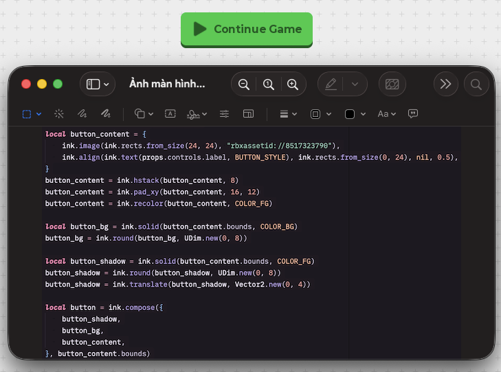
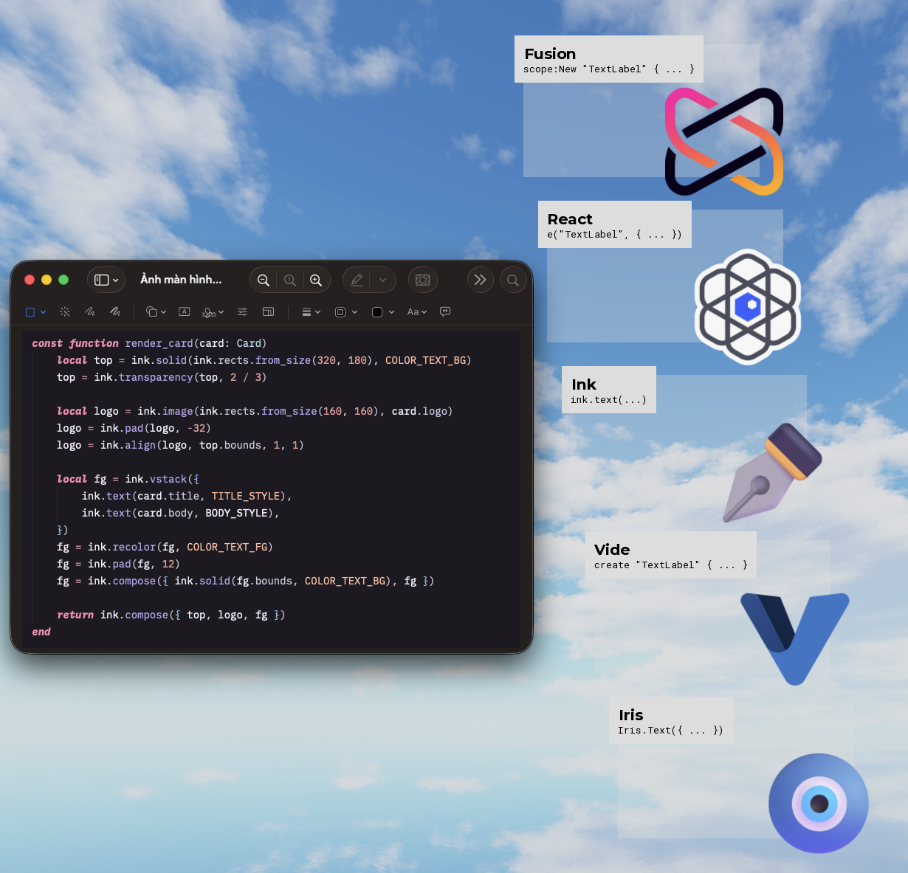

# Ink

Ink is an immediate mode UI library for Roblox and Vortex that makes use of zero hierachy.
Ink is inspired by the principles outlined in Daniel P H Fox's Perfection: <https://fluff.blog/2026/09/13/i-made-my-perfect-ui-library.html>

## Examples

