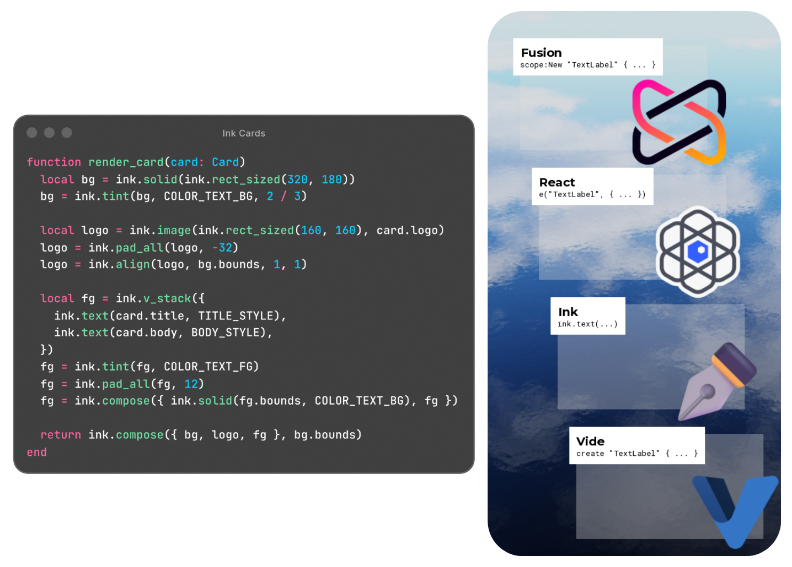

<div align="center">
    
    <h3>Zero-Hierarchy Immediate-Mode UI for Roblox</h3>
    
</div>

## About

Ink is an immediate-mode UI library for Roblox. Instead of building a tree of
instances and keeping it synchronized with your state, you compose entire UI,
every frame, with plain low-level `Rect` primitives.

- **No hierarchy.** Arrange your UI beyond the bounds of Roblox's UI system.
- **No object lifetimes.** State is stored at named keys that persists between frames. 
- **Input as hotspots.** Drag-and-drop, scroll views, and sliders are trivialized.

> [!WARNING]
> Ink is in early alpha. Ink's API will change between releases.

## Installation
 
```sh
embr add teamfireworks/ink
```

## Examples

### Composition

```luau
-- Everything Ink draws is a `Composite`, being a flat list of shapes with some
-- `Rect` bounds. Ink renders `Composite` and it's shapes from first to last.
--
-- There's four main "primitive" composites: solid colors, texts, images, and
-- hotspots. Let's start building up a button!

-- `ink.text` takes in a `TextStyle`. It's recommended to define `Style` tables
-- outside of your main render loop as to avoid wasting reallocations.
const BUTTON_STYLE: ink.TextStyle = {
	size = 18,
	font = Enum.Font.GothamBold,
}
 
-- ...into the render loop...

-- Components are plain functions, much like other libraries.
const function button(scope: ink.Scope, label: string, on_activated: () -> ())
    local label = ink.text(label, BUTTON_STYLE)

    -- Ink's API members often return a new `Composite`, ie. they're immutable. 
    -- Remember to assign the same composite with the same variable!
    -- 
    -- Here, Ink creates a cloned `Composite` with it's bounds padded by `16`
    -- pixels horizontally and `12` pixels vertically.
    --
    -- It's worth noting, Ink always uses pixel values. You'll rarely see a
    -- `UDim`, if ever.
    label = ink.pad_xy(content, 16, 12)

    -- Right now, this button only has text. Let's give it a solid color
    -- background!
    local bg = ink.solid(label.bounds)
    bg = ink.round(bg, 4)

    -- Hotspots are an invisible region that detects what the pointer is doing
    -- to it, such as clicking and hovering.
    --
    -- `scope:key` here defines an inner value, which the hotspot will use to
    -- store itself. You'll see this pattern a lot!
    const hot, spot = ink.hotspot(scope, bg.bounds)
    if hot.clicked then
        on_activated()
    end

    -- Ink also comes with animation primitives. Let's add a hover animation!
    const BUTTON_COLORS = {
        [Enum.GuiState.Idle] = { bg = Color3.fromHex("#18CB40"), fg = Color3.fromHex("#0D5B1E") },
        [Enum.GuiState.Hover] = { bg = Color3.fromHex("#1AD545"), fg = Color3.fromHex("#0D5B1E") },
        [Enum.GuiState.Press] = { bg = Color3.fromHex("#16B63A"), fg = Color3.fromHex("#0D5B1E") },
    }

    const colors = BUTTON_COLORS[hot.state]
    const bg_color = ink.tween(colors.bg, 0.3, Enum.EasingStyle.Quart)
    const fg_color = ink.tween(colors.fg, 0.3, Enum.EasingStyle.Quart)

    -- Many function arguments in Ink have optional values.
    -- Here `tint` applies a color, but it can also apply transparency!
    bg = ink.tint(bg, bg_color)
    label = ink.tint(label, fg_color)

    -- `compose` bounds composites together, such that layouts move these
    -- as one unit.
    --
    -- Order matters here! First composites are rendered first.
    return ink.compose({ bg, label, region })
end

-- Let's try rendering some layouts.
--
-- Now, usually on other libraries, you'll have to make some UIListLayouts,
-- or, maybe throw in a `use_next_order()` here, and there.
--
-- Ink might suprise you.

const function ui(scope: Scope)
    -- Layout functions often take an array of composites. Let's create some.
    const buttons = {}
    for index, action in { "Like", "Subscribe", "Notifications" } do
        local btn = button(scope, label, function()
            print(action, "pressed")
        end)

        -- Ooh! Let's stagger them, for fun!
        local multiplier = index - 1
        local margin = multiplier * 24
        btn = ink.translate(btn, margin, 0)

        buttons[index] = btn
    end

    const list = ink.v_stack(buttons, 8)

    -- Your eyes are not deceiving you.
    
    -- It's that easy.

    return list
end
```

### Mounting

```luau
-- Ink is set up with three independent parts, being the scope, the renderer,
-- and the intents.
--
-- Each one can be adapted out for a different environment, such as a storybook
-- plugin like UI Labs, or another platform like Vortex.

const scope = ink.scope.new()

-- The intent listens to an input source (here, UserInputService) and needs
-- to know where your UI is on screen.
--
-- This callback converts a screen position into a position relative to `root`.
const intent = ink.roblox_intent.new(UserInputService, function(position)
	return position - root.AbsolutePosition
end)

const root = Instance.new("ScreenGui")
root.Parent = Players.LocalPlayer.PlayerGui
const renderer = ink.roblox_renderer.new(root)

-- Here, Ink is rendered every `PreRender`.
-- You don't have to use RunService! Feel free to render every ECS phase or on
-- `PreSimulation` like a pyschopath.
const render_loop = RunService.PreRender:Connect(function(dt)
	-- First, advance time. This brings up state set last frame.
	scope:next(dt)

	-- Then, work out what the player did to the hotspots seen last frame.
	ink.update_intent_state(intent.state, intent:take())

    -- Now, compose your UI!
    const composite = render_ui(scope)

	-- When updating your UI, hotspots may have been rearranged.
    -- You'll need to "commit" the updated hotspots to your intents.
	intent:commit(composite)

    -- Now, finally, render it!
    renderer:render_composite(composite)
end)

-- To clean up Ink:
plugin.Unloading:Once(function()
    render_loop:Disconnect()
    intent:destroy()
    renderer:destroy()
end)
```

## Attribution

Ink is based on the ideas of Daniel P. H. Fox's three-part series,
[I made my perfect UI library](https://fluff.blog/2026/09/13/i-made-my-perfect-ui-library.html).

Ink is available [under the MIT License.](./LICENSE)
